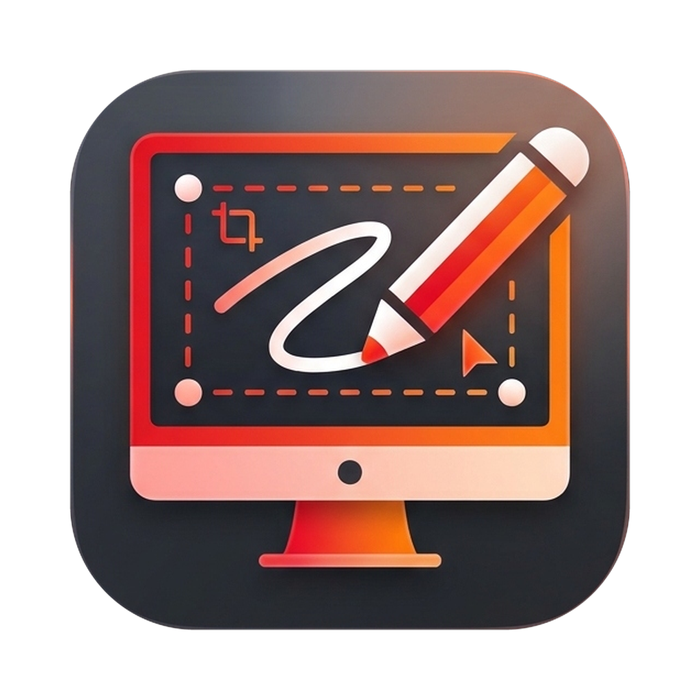

<p align="center">
  
</p>

<h1 align="center">ScreenEditing for macOS</h1>

<p align="center">
  Native macOS screen annotation, whiteboard, cursor highlight, spotlight, and live cursor zoom application built with Swift 5.9 (<code>AppKit</code> + <code>SwiftUI</code> + <code>ScreenCaptureKit</code>) and a C++20 geometry engine (<code>CoreEngine</code>).
</p>

## Architecture

- **`Sources/CoreEngine`**: C++20 geometry and stroke engine (`ce_smooth_stroke`, `ce_constrain_line`, `ce_make_rect`, `ce_build_arrow_polygon`, `ce_build_shape_polygon`, hit-testing, marquee intersection, bounding box, and auto-erase expiration).
- **`Sources/PresentifyCore`**:
  - `Models/`: `AnnotationModels`, `AnnotationCanvasState`, and `AppSettings`.
  - `Shortcuts/`: `ShortcutManager` with 32 configurable global, annotation, and cursor shortcuts backed by Carbon `RegisterEventHotKey`.
  - `Annotation/`: `AnnotateOverlayController`, `AnnotatePanel`, `AnnotateCanvasView`, `AnnotateControlsView`, `AnnotateShortcutsView`, `ToastWindowController`, and `Screenshotter`.
  - `Cursor/`: `CursorHighlightWindowController`, `CursorSpotlightWindowController`, `CursorZoomWindowController`, and `ScreenCaptureManager`.
  - `UI/`: 6-tab `SettingsView` (`General`, `Annotate`, `Cursor`, `Shortcuts`, `Other apps`, `About`), `PresentifyMenuView`, `PresentifyDockMenuController`, and 6-page `WelcomeTourView`.
  - `Updater/`: `AppUpdater` and `UpdateNotificationView` for automatic GitHub release checks and one-click in-app updates.
  - `App/`: `PresentifyAppController`.
- **`Sources/Presentify`**: Executable entry point launching `NSApplication` with `PresentifyAppController`.

## Build, Test & Package

```bash
swift build
swift test
swift build -c release
bash scripts/bundle-app.sh --install
```

Running `bash scripts/bundle-app.sh --install` builds `build/ScreenEditing.app`, packages `build/ScreenEditing.app.zip`, and installs `/Applications/ScreenEditing.app`.

## Automated GitHub Releases & In-App Updates

Pushing a version tag triggers `.github/workflows/release.yml` on `macos-14` to run the test suite, stamp `CFBundleShortVersionString`, package `ScreenEditing.app.zip`, and publish a GitHub Release that existing `ScreenEditing.app` installations detect and install automatically:

```bash
git tag v8.2.0 && git push origin v8.2.0
```
