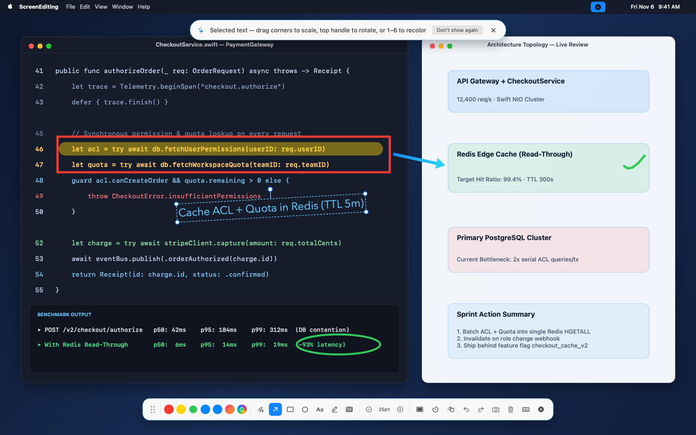
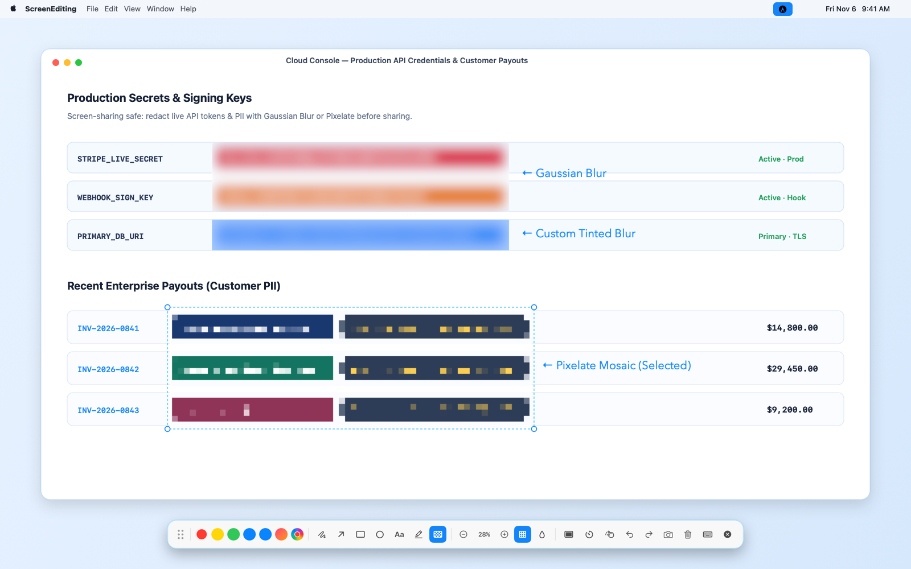
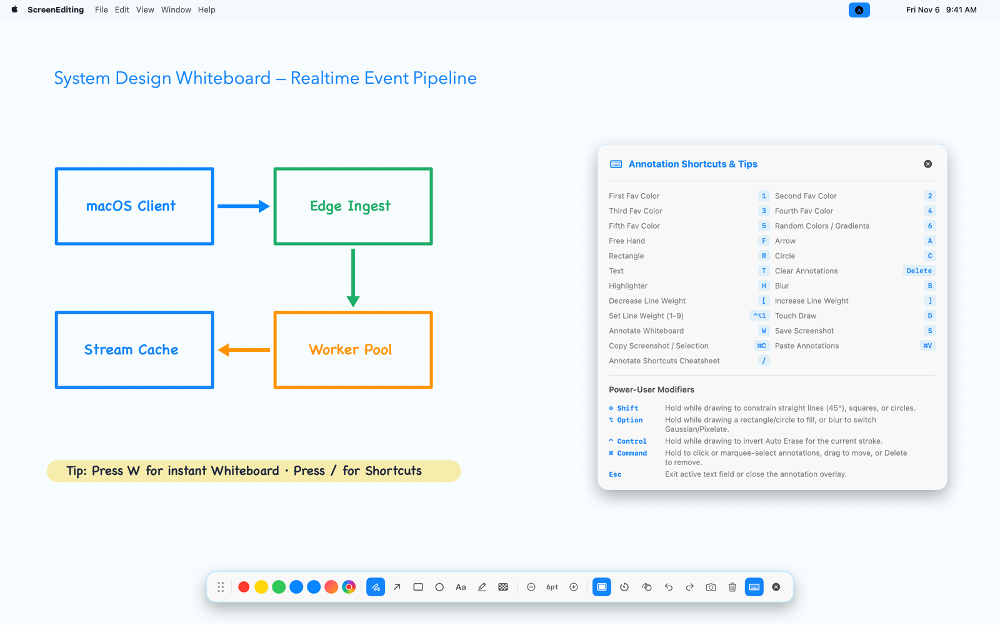
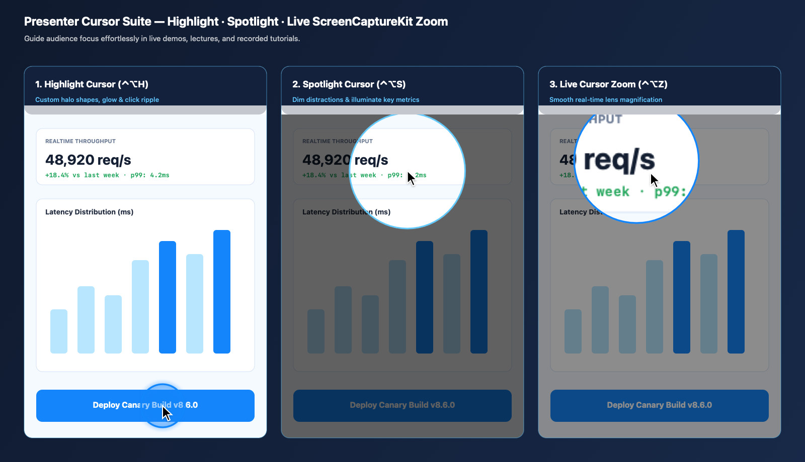
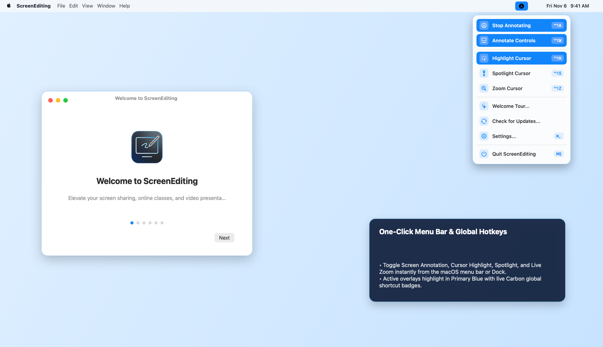
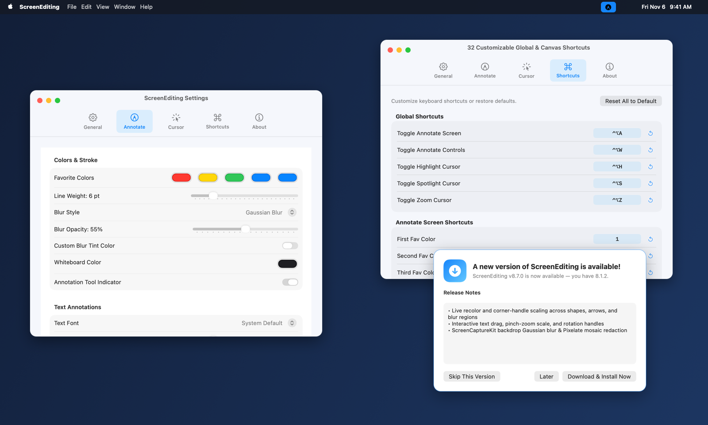

<p align="center">
  
</p>

<h1 align="center">ScreenEditing for macOS</h1>

<p align="center">
  <strong>Native macOS screen annotation, privacy blur, whiteboard, cursor highlight, spotlight, and live cursor zoom utility.</strong><br/>
  Built with Swift 5.9 (<code>AppKit</code> + <code>SwiftUI</code> + <code>ScreenCaptureKit</code>) and a C++20 geometry engine (<code>CoreEngine</code>).
</p>

<p align="center">
  <a href="https://github.com/minhphuc010194/ScreenEditing/releases/latest">
    
  </a>
  
  
  
</p>

<p align="center">
  
</p>

---

## Why ScreenEditing?

Whether you are leading a live architecture review, teaching an online class, pair-programming over Zoom/Meet, or recording product tutorials, **ScreenEditing** stays out of your way in the macOS menu bar until you hit a hotkey—letting you draw, highlight, redact sensitive tokens, open a full-screen whiteboard, or magnify fine UI details over **any window or full-screen space**.

---

## Real-World Usage Gallery

### 1. Live Screen Annotation & Interactive Transform Controls
Draw smooth freehand ink, `CoreEngine` arrows, rectangles, circles, translucent highlights, and callout text directly over code editors, slides, or browsers. Select any item (`⌘`-click, marquee drag, or right after drawing) to **recolor live (`1`–`6`)**, **drag**, **scale from corner handles**, or **rotate text** with trackpad gestures and rotation handles.

<p align="center">
  
</p>

### 2. Screen-Sharing Privacy: Live Gaussian Blur & Pixelate Redaction
Hide API keys, database URIs, and customer PII before recording or taking a screenshot. Switch between **Gaussian Blur** (with adjustable opacity and optional custom tint) and **Pixelate Mosaic** (`B`, or hold `⌥ Option` while dragging to toggle styles on the fly).

<p align="center">
  
</p>

### 3. Instant Full-Screen Whiteboard & Built-In Shortcuts Cheatsheet
Press `W` while annotating to flip into a clean **Whiteboard** canvas for spontaneous system design diagrams or lecture notes. Press `/` at any time to toggle the floating **Annotation Shortcuts & Power-User Modifiers** reference panel.

<p align="center">
  
</p>

### 4. Presenter Cursor Suite: Highlight, Spotlight & Live Zoom
Guide viewer attention without drawing a single stroke:
- **Highlight Cursor (`⌃⌥H`)**: Customizable halo shapes (`Circle`, `Squircle`, `Rectangle`, `Rhombus`), glow, and click animations.
- **Spotlight Cursor (`⌃⌥S`)**: Dims surrounding screen clutter while illuminating the active area around your pointer.
- **Zoom Cursor (`⌃⌥Z`)**: Smooth real-time `ScreenCaptureKit` magnification lens (plus full-screen zoom mode).

<p align="center">
  
</p>

### 5. Menu Bar Quick Toggle & Guided Onboarding Tour
Control every overlay with one click from the native macOS menu bar popover or Dock menu, complete with live global shortcut badges and a 6-step **Welcome Tour** on first launch.

<p align="center">
  
</p>

### 6. Native 5-Tab Settings & One-Click GitHub Auto-Updater
Fine-tune favorite colors, stroke weights, blur appearance, whiteboard themes, cursor effects, and all **33 configurable shortcuts**. Existing installations automatically check GitHub Releases and install updates in one click.

<p align="center">
  
</p>

---

## Default Keyboard Shortcuts

### Global Shortcuts (Work Anywhere on macOS)

| Action | Default Shortcut |
| :--- | :--- |
| **Toggle Annotate Screen** | `⌃⌥A` |
| **Toggle Annotate Controls Toolbar** | `⌃⌥W` |
| **Toggle Highlight Cursor** | `⌃⌥H` |
| **Toggle Spotlight Cursor** | `⌃⌥S` |
| **Toggle Zoom Cursor** | `⌃⌥Z` |

### Canvas Tools & Power-User Modifiers (While Annotating)

| Key / Modifier | Behavior |
| :--- | :--- |
| `F` / `A` / `R` / `C` / `T` / `H` / `B` | Switch to **Free Hand**, **Arrow**, **Rectangle**, **Circle**, **Text**, **Highlighter**, or **Blur** |
| `1` – `5` / `6` | Pick **Favorite Color 1–5** or **Random Vivid Gradient** (also live-recolors selected items) |
| `[` / `]` | Decrease / increase **Line Weight**, **Text Size**, or **Blur Opacity** |
| `W` / `/` | Toggle **Whiteboard** canvas / Toggle **Shortcuts Cheatsheet** |
| `S` / `⌘C` / `⌘V` | **Save Screenshot** / **Copy Screenshot or Selection** / **Paste Annotations** |
| `⌘Z` / `⇧⌘Z` / `Delete` | **Undo** / **Redo** / **Clear or Delete Selected** |
| **Hold `⇧ Shift`** | Constrain straight `45°` lines, squares, or circles |
| **Hold `⌥ Option`** | Fill rectangles/circles, or switch Blur between **Gaussian** and **Pixelate** |
| **Hold `⌃ Control`** | Invert **Auto-Erase** for the current stroke |
| **Hold `⌘ Command`** | Click or marquee-select annotations to move, scale, rotate, recolor, or delete |

---

## Installation

### Option 1: Download Prebuilt App (Recommended)
1. Download `ScreenEditing.app.zip` from the [**Latest GitHub Release**](https://github.com/minhphuc010194/ScreenEditing/releases/latest).
2. Unzip and drag **`ScreenEditing.app`** into `/Applications`.
3. Launch **ScreenEditing** and grant **Screen Recording** permission in **System Settings → Privacy & Security** when prompted (used for annotated screenshots, live blur/pixelate redaction, and cursor zoom).

### Option 2: Build & Install from Source

```bash
git clone https://github.com/minhphuc010194/ScreenEditing.git
cd ScreenEditing

swift build
swift test
bash scripts/bundle-app.sh --install
```

Running `bash scripts/bundle-app.sh --install` compiles a universal release build, packages `build/ScreenEditing.app` and `build/ScreenEditing.app.zip`, and installs `/Applications/ScreenEditing.app`.

---

## Architecture

- **`Sources/CoreEngine`**: C++20 geometry and stroke engine (`ce_smooth_stroke`, `ce_constrain_line`, `ce_make_rect`, `ce_build_arrow_polygon`, `ce_build_shape_polygon`, hit-testing, marquee intersection, bounding box, and auto-erase expiration).
- **`Sources/PresentifyCore`**:
  - `Models/`: `AnnotationModels`, `AnnotationCanvasState`, and `AppSettings`.
  - `Shortcuts/`: `ShortcutManager` with 33 configurable global, annotation, and cursor shortcuts backed by Carbon `RegisterEventHotKey`.
  - `Annotation/`: `AnnotateOverlayController`, `AnnotatePanel`, `AnnotateCanvasView`, `BackdropBlurRegionView`, `AnnotateControlsView`, `AnnotateShortcutsView`, `ToastWindowController`, and `Screenshotter`.
  - `Cursor/`: `CursorHighlightWindowController`, `CursorSpotlightWindowController`, `CursorZoomWindowController`, and `ScreenCaptureManager`.
  - `UI/`: 5-tab `SettingsView` (`General`, `Annotate`, `Cursor`, `Shortcuts`, `About`), `PresentifyMenuView`, `PresentifyDockMenuController`, and 6-page `WelcomeTourView`.
  - `Updater/`: `AppUpdater` and `UpdateNotificationView` for automatic GitHub release checks and one-click in-app updates.
  - `App/`: `PresentifyAppController`.
- **`Sources/Presentify`**: Executable entry point launching `NSApplication` with `PresentifyAppController`.

## Automated GitHub Releases & In-App Updates

Pushing a version tag triggers `.github/workflows/release.yml` on `macos-14` to run the test suite, stamp `CFBundleShortVersionString`, package `ScreenEditing.app.zip`, and publish a GitHub Release that existing `ScreenEditing.app` installations detect and install automatically:

```bash
git tag v8.6.1 && git push origin v8.6.1
```
